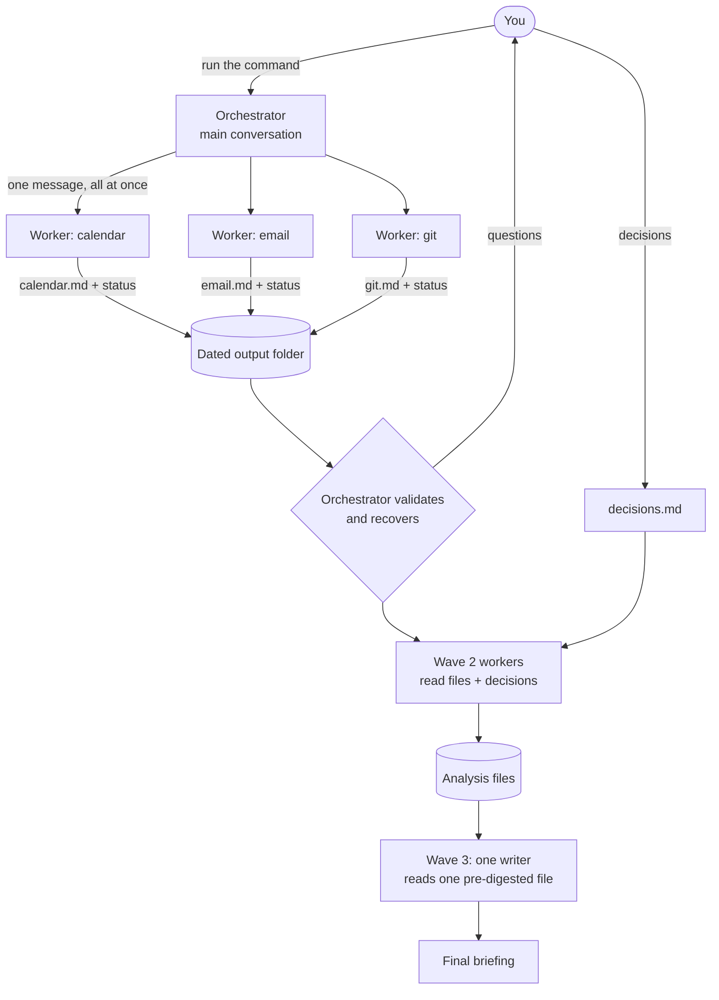

# Wave orchestration

How I run a group of AI agents in parallel without them stepping on each other, built from the morning routine I run every day and the talk I gave about it in March 2026 ("How I Built an AI That Knows My Day Before I Do").

There is a small working example next to this guide: [wave-digest](../../plugins/wave-digest/). It runs the whole pattern on a folder of code projects in under a minute.

## The problem

Every morning I used to spend 30 to 45 minutes just figuring out what to work on first. Email, calendar, my task list, git, a few newsletters, and that's 6 to 8 context switches before anything productive happens. And none of those tools talk to each other. Gmail doesn't know about my calendar. My calendar doesn't know about my task list.

So I built a slash command that reads all of them at once. The version I showed in the talk had 11 specialist agents, 3 waves and 2 points where it stops and asks me. The first wave, five agents fetching data at the same time, came back in about 90 seconds. A full run with every module took around 15 minutes, used about 620K tokens and cost about $2 a day (my numbers from March 2026; yours will differ).

You could try to do all of that in one long chat. It falls apart for two reasons. The context fills up with raw email and calendar data until the model starts forgetting its instructions (context rot). And everything happens one step at a time, so five sources take five times as long.

## The mental model

My first outline for the talk framed Claude Code as a company: you are the CEO, agents are employees, connected tools are departments. The version I presented used a kitchen, and that's the one I'll use here.

- **You are the owner.** You decide what's on the menu and you taste the plate before it goes out.
- **The orchestrator is the head chef.** It's the main conversation. It reads the recipe (your slash command or skill), hands out jobs, checks what comes back, and asks you the questions that need a human.
- **Subagents are prep cooks.** Each one gets one recipe, a clean station (a fresh context window that knows nothing about your conversation), and a badge that limits which tools it can touch.
- **The pickup window is a folder.** A prep cook puts the chopped onions on the window and leaves. The head chef picks them up. Prep cooks never talk to each other.

That last point is the entire coordination pattern. Agents write files. The next wave reads those files. No message bus, no shared memory, no agent-to-agent chat.

The other thing I'd underline from the talk: writing the agent prompt *is* the engineering. Each prep cook only knows what's in its recipe, so the recipe has to carry everything: the date, the exact output path, what to do when something fails, and what it's never allowed to do.

## Anatomy of a wave



A wave is a set of jobs that don't depend on each other. My morning routine runs like this:

1. **Wave 1, gather.** Calendar, email, git, project folders and news, all launched in one message. While they run, the orchestrator does the one read that has to be exact itself (more on that below).
2. **Between waves, the orchestrator works.** It validates every file, recovers anything that failed, cross-references the sources, and asks me the targeted questions. Which meetings need prep? Which emails should get a draft reply?
3. **Wave 2, analyze.** Meeting prep, draft replies, a task review and a few content ideas, all reading the Wave 1 files plus my answers. Fan-out here can be dynamic: one meeting-prep agent per meeting I picked.
4. **Wave 3, synthesize.** One agent writes the final briefing and the hand-off prompts for work I can pass to a fresh session.

Two rules make it work. Launch every agent in a wave in a single message, so they actually run in parallel. Then stop and wait for them to finish. Don't poll their files while they run.

## The file handoff contract

Every run gets a dated folder, and every agent prompt gets today's date, the day of the week, and the absolute path to that folder.

```
output/2026-01-05/
  calendar.md  email.md  git.md        # one file per agent
  decisions.md                          # what I approved and rejected
  .status/calendar.json  email.json ... # one status file per agent
```

Each agent writes its status file twice, once when it starts and once when it ends:

```json
{
  "agent": "email",
  "status": "complete",
  "started_at": "2026-01-05T08:01:23Z",
  "completed_at": "2026-01-05T08:01:45Z",
  "output_files": ["email.md"],
  "errors": []
}
```

`status` is `running`, `complete`, `partial` or `error`. In Claude Code the completion notification is what tells the orchestrator a worker is done. The status files are for validation, debugging and looking back at a run later. An outside review of my architecture assumed the orchestrator needed to poll them, which is worth knowing so you don't build that.

Three more pieces earned their place:

- **`decisions.md`.** After I answer the questions, the orchestrator writes down what I approved and rejected. Later waves read it first. Without it, a Wave 2 agent would happily re-propose the task I just said no to.
- **JSON for anything a script reads.** Markdown is fine for things I read. If code consumes it, give it a schema.
- **"Always write your file."** Even when every tool call fails, the agent writes its output with `status: error` and what went wrong. A missing file and a failed fetch should look different.

## What stays with the orchestrator, and why

This is the lesson I'd most want someone to take from my build.

My task list lives in a database I query through an MCP tool. At first a background agent did that query like everything else. It came back with a clean, plausible list of tasks. They were fake. In my words from the talk: "The AI didn't say 'I can't access that.' It made up plausible data instead." In 3 test runs, the same query returned my real tasks when the main conversation ran it and invented ones when a background agent ran it. I don't know the exact cause, and newer versions may behave differently. That's what I saw on my setup at the time, so test it on yours. I moved that query into the orchestrator's foreground and stopped seeing it.

So my split is:

- **Foreground (orchestrator):** anything that must be exactly right and comes from a live system, and anything that changes the outside world. Sending, labeling, creating records. Those also sit behind an approval step. In the talk I put it as "Drafts, not sends. Proposals, not actions."
- **Background (workers):** reading, summarizing, and writing a file in the output folder.
- **Shared writes get resolved once, up front.** When two meeting-prep agents ran in parallel and met the same new contact, both tried to create the same record. The fix was to have the orchestrator look up and create every contact once, before the fan-out, and pass the IDs into each agent. Workers only read and update.

One more Claude Code detail from my architecture notes: background agents couldn't read or write agent and command files under `~/.claude/`. Change agent definitions from the main conversation.

## Failure handling

Every wave ends the same way: check, recover, move on.

1. **Check every expected file exists.** My first full production run turned up 7 issues, and one was that background agents sometimes reported success but never actually wrote the file. Now every agent runs `[ -f "$file" ] && echo OK` after writing, and the orchestrator checks again.
2. **Recover from the reply first.** If the file is missing but the agent's reply has the content, write the file from the reply. Otherwise re-run the fetch yourself in the foreground.
3. **Catch the planning stall.** Sometimes an agent answers with "Here's my plan, shall I proceed?" and writes nothing. If the reply looks like that and the file is missing or 3 lines or fewer, re-launch it once with `EXECUTE NOW - DO NOT PLAN. Write your output file immediately.` at the top. Only re-run agents that are read-only or safe to repeat.
4. **Distrust empty results.** A calendar agent saying "no events today" gets a quick direct check, because an empty answer is exactly what a broken fetch looks like. I hit this again while building the example for this guide: my `find` command excluded any path containing `wave-digest`, which included the folder being scanned, and two workers honestly reported "no repos found." The file check passed. Only a spot check caught it.
5. **Never fabricate.** A failed source shows up as failed in the final output. In the read-only version of my routine, any source that's late, blocked or errored gets a row in a coverage strip, so it never just looks like nothing happened.
6. **Keep the retry count out of the prompt.** The same outside review pointed out that models are bad at counting their own retries. My agent prompts say "if a call fails, note it and continue, don't retry," and the orchestrator decides what to re-run.
7. **Keep a known-issues file.** The run reads it at the start and adds to it at the end, so the next morning's run applies the workaround instead of rediscovering the bug.
8. **Later waves still run.** If one Wave 1 agent failed, Wave 2 runs with what it has and says what's missing.

## Model and timeout choices

I run every worker on Sonnet. I started on Haiku because it's cheaper and faster, and it failed more in integration testing: tool call failures, problems with the Write tool, weaker error handling. The difference was about $0.50 a run, which for a once-a-day routine was an easy call. If you try a cheaper model, test it against real data first.

Set time limits outside the model. My limits were about 2 minutes for a light fetch, 3 for a project scan, and 5 for the news pipeline, which reads a lot. If an agent times out, note it and continue with what you have. One caveat: the subagent tool in current Claude Code has no per-agent timeout field that I could find (checked November 2026), so in Claude Code a hung agent shows up as a wave that never finishes. The Codex script in the example enforces a real timeout per process.

The last agent in the chain needs special care. My delegation agent originally read 10+ raw files from earlier waves. Its context overflowed and it ran for 60+ minutes without writing anything. The fix was for the orchestrator, which already had everything in context, to write one compact input file under 200 lines for that agent. If the final writer reads more than a few files, pre-digest them.

## When not to use waves

- **When agents need to talk to each other.** Waves are a report-back pattern. If the work needs back-and-forth, look at Claude Code's Agent Teams instead. I picked plain subagents because a report-back job didn't need the back-and-forth, and teams add coordination overhead I didn't need.
- **When two agents would write the same thing.** Same file, same database record, same branch. Resolve it in the orchestrator first, or run those jobs in sequence.
- **When the job is just a command.** If a worker would only run `git log` and paste the result, run `git log`. My read-only morning variant replaced several model steps with plain scripts that cost zero tokens.
- **When there's no human gate between waves.** In that same read-only variant there are no approval questions, so Wave 1 and Wave 2 collapse into one parallel wave. Waves exist to wait for something. If nothing needs waiting for, use fewer of them.
- **When it's small.** One agent writing one file is a fine system. Mine has 11 agents, but the advice from the talk still holds: build one agent per source, test each one alone with real data, then wire them together.

## Use cases

What I've built with this pattern:

- **Morning brief.** The routine above. Gather in parallel, ask me, analyze in parallel, write one briefing.
- **Read-only flash version.** Same agents, no approval steps, nothing that sends or changes anything, one wave, plus a coverage strip. Good when I just want to look.
- **One agent per item.** When new meeting transcripts arrive, one agent per transcript extracts what matters into its own file. Same for meeting prep, one agent per confirmed meeting.
- **A pipeline inside a worker.** My news agent skims 50 to 70 stories from newsletters, RSS and GitHub trending, ranks them, then reads the top few in depth. A worker can run its own small waves.
- **Multi-model review.** Several reviewers from different model families look at the same code change in parallel without seeing each other's work, and the orchestrator checks the disagreements. That's the [multi-review](../../plugins/multi-review/) skill in this repo.

Where I think it fits, though I haven't built these exact ones:

- **Research sweeps.** One agent per source or per question, each writing notes with links, then one writer. On my own laptop I keep web research to about 5 agents at once; that's my working limit, not a tested number, so find yours.
- **Code or docs reviews by area.** One agent per folder or per concern (security, tests, docs), then one report.
- **Multi-source reports.** A weekly status report pulled from a tracker, a repo and a shared folder.
- **Migration or upgrade checks.** One agent per package or service, each answering the same checklist into its own file.

## Running it in other agents

**Claude Code** supports this natively. Subagents get fresh context, run in parallel when launched in one message, and notify the main conversation when they finish. Everything above was built and run there. If your background agents need MCP tools, check that the tools are allowed for background agents in your settings; for me that was a real prerequisite.

**Codex CLI** has no subagent tool, so the orchestrator becomes a shell script. Each Wave 1 job is a `codex exec` process started with `&`, the script `wait`s, then runs the validation and starts Wave 2. Two flags do most of the work: `-s read-only` keeps each worker from changing files, and `-o <file>` writes the worker's final message to a file. So the script writes every file, and the models only read and print. The example's `codex-wave.sh` does exactly this.

What I actually tested, on macOS with Codex CLI 0.163, on a small sample folder:

- A full run (3 parallel workers, then a writer) finished in about 45 seconds and produced a correct digest. I ran it twice.
- A forced 1-second timeout marked all three workers as `error`, the writer reported no digest, and the script exited non-zero. That test also caught a bug: killing the `codex` launcher left its child process running, so the script now kills the whole process group.

What I did not test: Gemini CLI (not installed on my machine), Antigravity, other agents, and Linux or Windows. The pattern only needs a way to run a prompt from a shell and capture the answer to a file, so it should carry over, but I haven't checked.

## Try it

Install [wave-digest](../../plugins/wave-digest/) and run it on a folder of projects. Then open the output folder and read the status files and the per-worker files before you read the digest. That's the part to copy. Swap the three scans for your own sources, keep the contract, and keep the check-and-recover step between waves.
